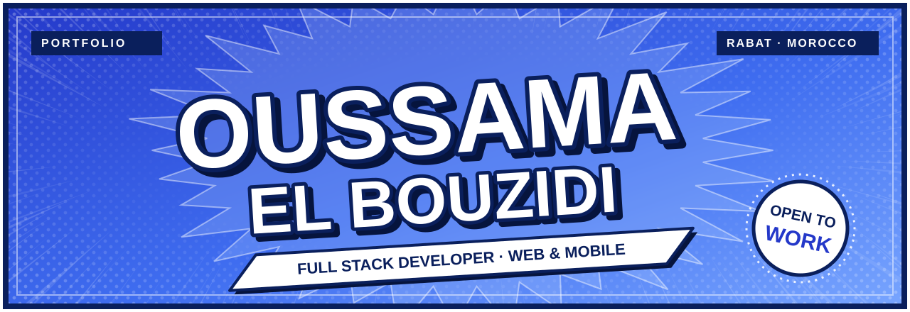
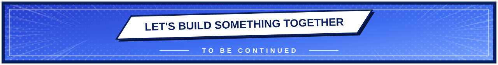

ゴ ゴ ゴ ゴ ゴ

<table width="100%">
<tr>
<td width="50%" valign="top">

CHAPTER 01

### ABOUT

Junior Full Stack Developer based in **Rabat, Morocco** 🇲🇦

I build web and mobile applications end to end, from React interfaces to backend APIs, with a focus on clean, maintainable code.

Bachelor's degree in Computer Systems Engineering (SupMTI) and a Digital Development diploma (ISTA).

</td>
<td width="50%" valign="top" align="center">

CHAPTER 02

### ARSENAL

FRONTEND · React Native

BACKEND

DATA & DEVOPS

</td>
</tr>
<tr>
<td colspan="2" valign="top">

CHAPTER 03

### MISSION · LM3ALEM

*Final-year project*

A web platform that lets craftsmen (carpenters, mechanics, technicians) create and manage their professional profiles.

- **Backend:** Laravel REST API, JWT authentication
- **Frontend:** React.js, TypeScript, Zustand, shadcn/ui
- **Deployment:** Docker containers, PostgreSQL database

</td>
</tr>
<tr>
<td width="50%" valign="top">

CHAPTER 04

### CHRONICLE

- **2024 – 2025** · Bachelor's degree in Computer Systems Engineering, SupMTI Rabat
- **April 2024** · Web development internship, MJTech
- **2022 – 2024** · Specialized Technician Diploma in Digital Development (Full Stack), ISTA Témara

</td>
<td width="50%" valign="top" align="center">

CHAPTER 05

### STATUS

**OPEN TO WORK**

Internships · Junior positions · Web & mobile projects

[Get in touch →](https://www.linkedin.com/in/oussama-el-bouzidi)

</td>
</tr>
</table>

ド ド ド ド ド

